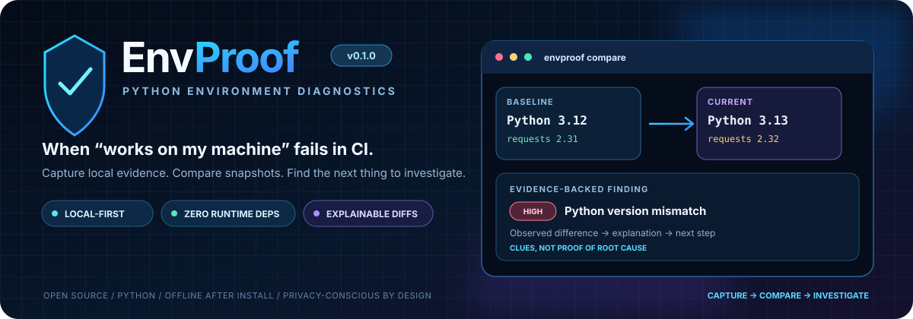
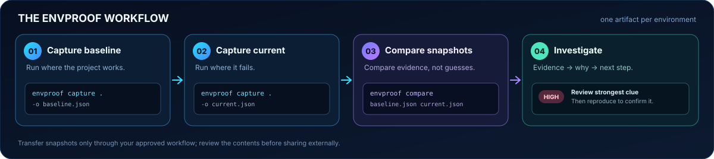
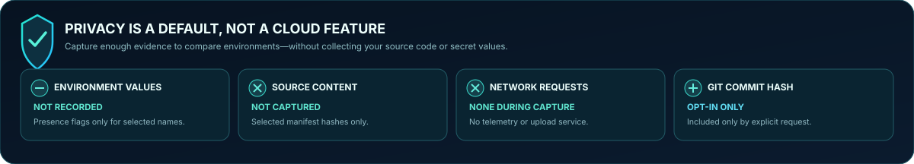
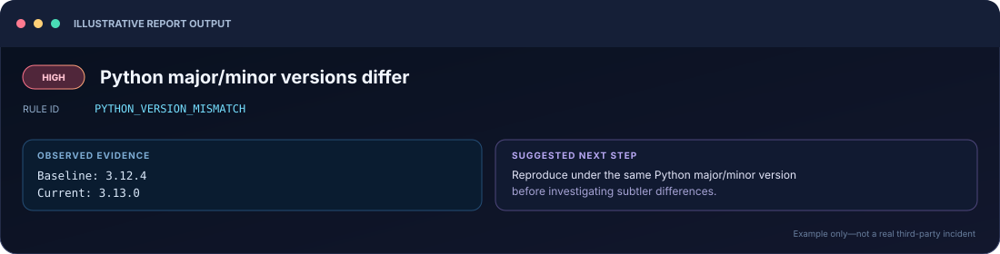
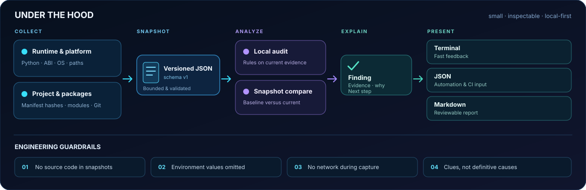

# EnvProof

**Evidence-backed Python environment diagnostics, without uploading your project.**

<p align="center">
  
</p>

<p align="center">
  
</p>

<p align="center">
  <strong>Capture once. Compare environments. Investigate with evidence.</strong><br/>
  <a href="#quick-start">Quick start</a> ·
  <a href="#visual-workflow">Visual workflow</a> ·
  <a href="docs/ARCHITECTURE.md">Architecture</a> ·
  <a href="docs/SECURITY_MODEL.md">Security model</a>
</p>

<p align="center">
  
  
  
  
</p>

EnvProof captures a privacy-conscious snapshot of the Python runtime and project metadata, then compares a known-good snapshot with a failing one. It highlights differences that commonly explain “works on my machine” failures and gives each finding a rule ID, observed evidence, an explanation, and a practical next step.

> **Status:** first public-release candidate `0.1.0` (alpha). EnvProof is useful now, but it is not a root-cause oracle and has not yet been validated by a broad external user base.

## Visual workflow

<p align="center">
  
</p>

**The key idea:** compare a known-good snapshot with the incident environment, then use observed evidence and a suggested next step to guide a controlled investigation. Differences are clues—not proof of root cause.

## Why EnvProof?

Debugging Python environment issues often means collecting several different facts manually: which interpreter ran, whether a virtual environment was active, which distributions were installed, what `sys.path` looked like, and whether a dependency manifest changed. EnvProof puts those facts into a versioned JSON snapshot so two runs can be compared consistently.

### What it does

- Captures Python version and implementation, interpreter identity, virtual-environment status, OS/architecture, import-search paths, selected environment-variable **presence flags**, installed distribution names/versions/locations, selected manifest fingerprints, and read-only Git state.
- Compares two snapshots and highlights Python/runtime, platform, `sys.path`, environment-flag, package, manifest, import-origin, and Git-state differences.
- Checks import origins without executing the selected module's code. Start with `--module json` or `--module requests`.
- Produces terminal, JSON, or Markdown output suitable for local triage, CI checks, or a bug report.
- Works offline after installation and has **zero mandatory runtime dependencies**.
- Refuses to overwrite output files unless `--force` is supplied.

### Privacy by default

<p align="center">
  
</p>

- Environment-variable **values are never captured**. For a small allowlist of diagnostic variables, EnvProof records only whether the variable is present.
- Project source files and `.env` files are never read or copied into the snapshot.
- Recognized project manifests are fingerprinted by filename, byte size, and SHA-256 only; their contents are not stored.
- Home, project, virtual-environment, and base-interpreter roots are redacted where possible.
- Git commit hashes are omitted unless `--include-commit` is explicitly passed.
- Capture makes no network requests and does not execute arbitrary shell commands. When enabled, Git integration uses a small set of fixed, read-only Git commands without a shell.

**Review a report before sharing it.** Package names, versions, path suffixes, platform details, commit hashes (if opted in), and manifest hashes can still reveal useful information about a private project. Path redaction is best-effort, not a guarantee of anonymity.

## Quick start

### Install from a checkout

Targets Python 3.10–3.14 in the initial CI matrix; only locally run versions are claimed as verified until CI passes.

```bash
git clone https://github.com/muhammadsaeed-ai/envproof.git
cd envproof
python -m venv .venv
```

Activate the environment, then install:

**Windows PowerShell**

```powershell
.\.venv\Scripts\Activate.ps1
python -m pip install .
```

**macOS / Linux**

```bash
source .venv/bin/activate
python -m pip install .
```

The public source repository is available at [`muhammadsaeed-ai/envproof`](https://github.com/muhammadsaeed-ai/envproof). EnvProof is **not published on PyPI**; `python -m pip install envproof` becomes the short installation route only after a separate, verified package publication.

### Audit the current environment

```bash
envproof audit --module json --module requests
```

A local audit may report that `PYTHONPATH` is set, that a shell activation variable does not match the active interpreter, or that a standard-library module resolves from inside the project. These are diagnostic clues—not automatic proof that a defect exists.

### Capture a known-good environment

Run this in the environment where the project works:

```bash
envproof capture . --module requests --output baseline.json
```

Transfer `baseline.json` using your normal approved workflow to the environment where the problem occurs. Do not share it externally until it has been reviewed.

### Compare against the failing environment

Run in the failing environment:

```bash
envproof capture . --module requests --output current.json
envproof compare baseline.json current.json --format markdown --output drift-report.md
```

Open `drift-report.md` and inspect the highest-severity findings first. A CI job can fail on discrepancies:

```bash
envproof compare baseline.json current.json --fail-on warning
```

`--fail-on warning` returns exit status `1` if at least one warning or high-severity finding exists. The default is `--fail-on never`, so reporting differences does not unexpectedly fail interactive use.

### Generate a shareable report

```bash
envproof report current.json --format markdown --output envproof-report.md
```

The JSON snapshot is the machine-readable source of truth; Markdown intentionally limits the package list to 60 rows by default.

## Commands

| Command | Purpose |
|---|---|
| `envproof --help` | Show commands and options |
| `envproof capture [PROJECT] -o snapshot.json` | Capture current Python/project evidence |
| `envproof audit [PROJECT]` | Run deterministic local diagnostics |
| `envproof compare BASELINE CURRENT` | Compare two snapshots |
| `envproof report SNAPSHOT` | Render Markdown or normalized JSON |
| `envproof --version` | Print installed version |

Useful options:

- `--module IMPORT_NAME`: record where one **top-level** import name resolves. Repeat as needed; dotted module names are intentionally rejected to avoid importing parent packages.
- `--include-commit`: include the Git commit hash. Off by default.
- `--no-git`: skip Git state checks entirely.
- `--format text|markdown|json`: choose comparison/audit report format.
- `--fail-on never|warning|high`: use findings as a CI gate.
- `--force`: explicitly allow overwriting an existing output.

For examples and exact field semantics, see [`docs/INSTALLATION.md`](docs/INSTALLATION.md), [`docs/ARCHITECTURE.md`](docs/ARCHITECTURE.md), and [`docs/SECURITY_MODEL.md`](docs/SECURITY_MODEL.md).

## Example finding

<p align="center">
  
</p>

The visual card is illustrative—not a claimed run against a real third-party project. The same kind of finding is also shown below in terminal format:

The following output is illustrative—not a claimed run against a real third-party project:

```text
[HIGH] Python major/minor versions differ
  Rule: PYTHON_VERSION_MISMATCH
  Evidence: Baseline: 3.12.4
  Evidence: Current: 3.13.0
  Why it matters: Python minor versions can change syntax support, standard-library behavior, ABI compatibility and dependency resolution.
  Suggested next step: Reproduce under the same Python major/minor version before investigating subtler differences.
```

## Architecture at a glance

<p align="center">
  
</p>

For component boundaries, schema decisions, input validation and output handling, see [the full architecture notes](docs/ARCHITECTURE.md).

## Design principles

1. **Evidence before conclusions.** Findings identify the data that triggered a rule.
2. **Local-first.** No telemetry, analytics, external API, or service account.
3. **Non-destructive.** Capture reads metadata and selected manifest files; it does not install packages, edit a project, or launch arbitrary user commands.
4. **Honest severity.** A difference is not automatically a bug. Findings say “may” or “can” when a causal link has not been verified.
5. **Stable, inspectable data.** JSON snapshots are versioned and human-readable; only JSON is loaded, never pickle or executable configuration.
6. **Small core.** Standard-library runtime only; optional developer tools are isolated in the `dev` extra.

## Limitations

- EnvProof reports clues; it cannot prove a root cause or guarantee reproduction.
- Module inspection is limited to explicitly requested top-level names. It does not execute imported modules or trace every dynamic import.
- Package inventory reads installed distribution metadata visible to the current interpreter; malformed or nonstandard installs may be incompletely represented.
- It fingerprints a fixed allowlist of project manifests plus top-level `requirements*.txt` / `requirements*.in`; it does not parse every build system or inspect arbitrary config files.
- Manifest hashes show that files differ, not which semantic change caused an error.
- Git dirty status covers tracked changes. Untracked files are not reported, and commit hashes are opt-in.
- Cross-platform coverage is configured in CI but must be confirmed by successful remote workflow runs; the initial local verification can validate only the host on which it is executed.
- The tool does not currently inspect GPU/driver stacks, native system-library dependencies, network reachability, subprocess traces, or live CI logs.

## Development and verification

```bash
python -m venv .venv
# Activate .venv using the instructions above
python -m pip install -e ".[dev]"
python -m unittest discover -s tests -v
python -m ruff check src tests examples benchmarks
python -m ruff format --check src tests examples benchmarks
python -m mypy src/envproof
python -m build
```

All runtime functionality is covered by standard-library `unittest` tests. The optional development toolchain includes pytest, Ruff, mypy, and build. For recorded checks and known verification limits, see [`docs/VERIFICATION.md`](docs/VERIFICATION.md). The controlled drift example is in [`examples/demo_drift.py`](examples/demo_drift.py).

## Roadmap

See [`CHANGELOG.md`](CHANGELOG.md) and [`docs/SPECIFICATION.md`](docs/SPECIFICATION.md). Priorities for post-v0.1 should be driven by real issue reports and repeatable examples, not feature count.

## Contributing

Bug reports, reproducible test cases, documentation improvements, and small rule proposals are welcome. Read [`CONTRIBUTING.md`](CONTRIBUTING.md) and [`SECURITY.md`](SECURITY.md) first. Please do not include API keys, real `.env` files, private source code, or unredacted diagnostic captures in public issues.

## License

MIT. See [`LICENSE`](LICENSE).
