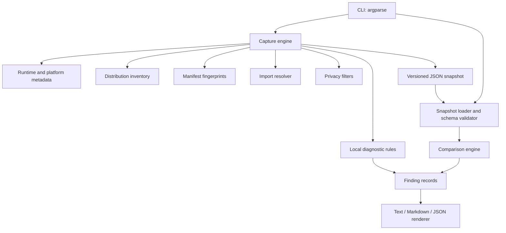

# Architecture

## Component overview

## Modules

- `envproof.cli`: argument parsing, orchestration and CLI exit-code policy.
- `envproof.capture`: runtime/project collectors, bounded JSON load/save, and schema validation.
- `envproof.privacy`: stable path redaction, bounded path-entry handling and environment-value omission.
- `envproof.compare`: pure comparison logic; turns observed differences into stable findings.
- `envproof.diagnostics`: deterministic local checks on an existing snapshot.
- `envproof.report`: text and Markdown renderers for issue/CI output.
- `envproof.errors`: single domain exception translated into a concise CLI error.

## Data flow

1. The CLI validates requested paths and options.
2. The capture engine reads interpreter metadata, installed distribution metadata and a short allowlist of project manifest files.
3. Manifest file content is streamed into SHA-256; only filename, status, size and digest are retained. `.env` files and arbitrary sources are excluded.
4. Environment variables are summarized as presence-only booleans for a fixed allowlist. No values are serialized.
5. Optional top-level import names are resolved with `BuiltinImporter`, `FrozenImporter`, and `PathFinder`; the selected module code is not imported or executed.
6. Optional Git status uses fixed read-only commands with `shell=False`, bounded execution time, no stdin, `GIT_OPTIONAL_LOCKS=0`, and `core.fsmonitor=false`; it does not store changed-file names. If status cannot be read successfully, the dirty-state value is unknown rather than reported as clean.
7. Output is a versioned JSON object. Loading accepts JSON only, has a 20 MiB bound, checks schema version and validates structural types.
8. Comparison is a pure function over two validated snapshots. Findings are sorted by severity and stable identifiers, then rendered.

## Snapshot schema (v1)

Top-level fields are `schema_version`, `tool`, `captured_at`, `python`, `platform`, `paths`, `environment`, `packages`, `project`, `modules`, and `privacy`. The schema is documented in code and is versioned independently of the package version.

Snapshots are evidence, not execution plans. The loader does not import code, invoke subprocesses, evaluate expressions, or accept pickle. Future schema changes that break current comparison semantics must increment the schema version.

## Design decisions

### ADR-001: Standard library for runtime behavior

**Decision:** Avoid third-party runtime dependencies.  
**Reason:** Environment diagnostics should remain installable in constrained or broken environments. `importlib.metadata`, `sysconfig`, JSON, hashing, subprocess and argparse cover the first-release requirements.  
**Trade-off:** The implementation avoids parsing arbitrary PEP 508 requirements and does not promise complete semantic dependency validation.

### ADR-002: Presence-only environment variables

**Decision:** Record allowlisted names as booleans; never record values.  
**Reason:** Values can include passwords, access tokens, internal hostnames, custom indexes and private filesystem paths.  
**Trade-off:** EnvProof cannot compare two different values that are both present. Users must inspect those values through their approved secure tooling.

### ADR-003: Manifest hashes, not contents

**Decision:** Fingerprint a bounded list of project manifests and top-level requirements files.  
**Reason:** It provides cross-environment change evidence without collecting source or configuration contents.  
**Trade-off:** A digest explains that a file differs, not how it differs. Review the file through version control to determine the semantic change.

### ADR-004: Explicit top-level import probes

**Decision:** Only inspect valid top-level module names, and resolve using finders rather than importing the target module.  
**Reason:** General `find_spec("package.submodule")` can import parent packages; user modules must not execute during capture.  
**Trade-off:** This does not trace dynamic imports, dotted submodules, or custom import behavior fully.

### ADR-005: Git commit is opt-in

**Decision:** By default record repo detection and tracked dirty/clean state, but omit the commit hash.  
**Reason:** A commit hash may identify private repository history.  
**Trade-off:** Compare cannot use commit equality unless both captures were made with `--include-commit`.

## Error handling

Expected user/input errors raise `EnvProofError`, caught by the CLI and shown as `envproof: error: ...` with exit code 2. File output is flushed to a temporary sibling and atomically published. Without `--force`, publication uses a no-clobber hard link; with `--force`, an existing target is replaced atomically. Existing output is never silently overwritten by default.

## Future extension points

- Additional collectors should be small, bounded and individually optional.
- New findings should include evidence fields and tests for positive, negative and malformed input cases.
- New snapshot fields require schema compatibility consideration.
- Integrations should remain offline by default and must not upload snapshots without explicit user action.
